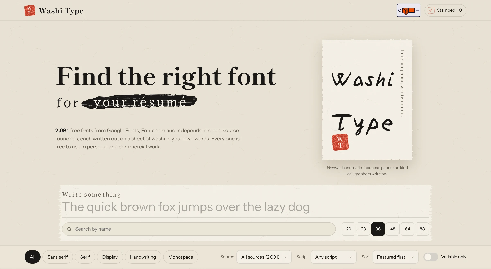

# Washi Type

A font finder dressed as a calligrapher's desk. More than 2,000 free fonts from Google Fonts, Fontshare and independent open-source foundries, each written out on its own sheet of washi (handmade Japanese paper) in your own words. Stamp the fonts you like with a red seal, open a sheet to see every weight, tear off the ticket to copy the embed code, or press and hold the sheet to crumple it.

**Live:** https://washi-type.vercel.app

<picture>
  <source media="(prefers-color-scheme: dark)" srcset="docs/screenshot-dark.webp">
  
</picture>

## Run it

```bash
npm install
npm run dev        # http://localhost:5173
npm run build      # refreshes the font catalog, then builds dist/
npm run preview    # serves the production build on http://localhost:4173
npm run lint       # ESLint 10
npm test           # browser tests against the production build (run npm run build first)
npm run vendor:check   # checks no copied component changed without being recorded
```

`npm run build` does three things: refreshes the font catalog, builds the app with Vite, and writes a real HTML page for every font (`scripts/prerender.mjs`).

`npm test` uses Playwright and runs every test in Chromium, Firefox and WebKit (Safari's engine), plus the page tests on an emulated iPhone. The first time, install the browsers with `npx playwright install chromium firefox webkit`. To run only Chromium against a Chrome you already have: `PW_CHROME=/path/to/chrome npx playwright test --project=chromium`.

## Features

- **Write something:** every sheet shows your text in its font. With no text, each font shows a sample in a script it actually has, so a Khmer-only font isn't previewed in English.
- **Filters:** source, category, script (27 scripts, including Devanagari, Tamil, Bengali, Japanese and Arabic), variable fonts only, and four sort orders.
- **Font sheets:** every weight (with an italic toggle), licence, source, designer, a crumplable specimen, and the embed code on a ticket you tear to copy. Every font has its own page, such as `/fonts/inter`, which works with Back and Forward, can be bookmarked and shared, and is indexed by search engines (old `/#inter` links move there).
- **Stamped fonts:** press the seal on any sheet to keep it. The Stamped drawer lists them as paper slips; drag one into the shredder (or press Delete) to remove it, with Undo. Stamps stay in this browser.
- **Errors you can read:** a retro TV shows what went wrong instead of a blank page (see below).
- **Light and dark:** the site follows your device; the On/Off switch in the header picks one and remembers it in this browser (it's applied before the page paints, so there's no flash of the other theme).
- **Works offline after the first visit:** a service worker keeps a copy of the site, and says when you're looking at it.
- **Fast with 2,000+ fonts:** only the sheets near the screen exist on the page.

## Where the fonts come from

`scripts/build-catalog.mjs` builds `public/fonts.json` from three sources. Every font in it is free for personal and commercial use.

| Source | Fonts | Licence | Loaded from |
|---|---|---|---|
| Google Fonts | 1,907 | Mostly SIL Open Font License | fonts.googleapis.com |
| Fontshare (Indian Type Foundry) | 65 not already on Google Fonts | ITF Free Font License | api.fontshare.com |
| Independent foundries via Fontsource | 119 | OFL, Apache, MIT, CC0, Unlicense | cdn.jsdelivr.net (pinned to `@fontsource/*@5`) |

- Google Fonts comes from the data files published by [google-font-metadata](https://github.com/fontsource/google-font-metadata), read from jsDelivr at build time (pinned to version 6), with a trimmed snapshot in `data/google-fonts.json` as the fallback. Only its data is used, so the package itself isn't installed. Licences come from the same data; for the ~150 families it has no record for, the licence folder they sit in on the google/fonts repository (`data/google-licence-folders.json`). Three new families still link to Google Fonts for their licence.
- `npm run build` refreshes all three sources from the network and falls back to the snapshots in `data/` if one can't be reached. `npm run catalog` rebuilds from the snapshots only; `npm run catalog:live -- --save-snapshot` also refreshes the Google Fonts snapshot.
- The build checks the catalog (unique ids, valid weights and categories, enough Google fonts) and fails rather than ship a broken one. A single malformed entry from a live API is skipped, not fatal.
- Fontshare's licence doesn't allow redistributing the files, so Washi Type only displays them through Fontshare's servers and links to fontshare.com for downloads.

## Error screens

| What happened | What you see |
|---|---|
| An address that doesn't exist (e.g. `/about`) | Vercel serves `404.html` with a real 404 status: the TV shows **NOT FOUND 404** |
| `/fonts/<name>` for a font that isn't in the catalog | The same 404 page and status, titled "No font called …", with a button that opens the front page searching for that name (`/?q=<name>`) |
| Inside the app: a font that isn't in the catalog, or a garbled link | The TV in a dialog, with a button to search for the name |
| The font list can't be loaded | Retries twice, then the TV shows **NO SIGNAL 503** with Try again |
| You're offline | **NO SIGNAL OFF**; it retries by itself when the connection returns. If the site was visited before, it opens from the offline copy with a "you're offline" bar |
| The site can't be reached, or the connection is very slow | After 3.5 s the saved copy answers (from then on, straight away for 20 s), with a bar saying it's the copy saved on this device |
| A code file from an older deploy is gone, or anything crashes | Reloads once to pick up the new deploy; if that doesn't fix it, the TV shows **ERROR ERR** with Reload. A crash inside a font sheet only replaces that sheet |

Errors are also **reported to you**: `src/reportError.js` sends render crashes, missing code files, an unreachable font list and uncaught errors to `api/report.js`, a Vercel function that writes each one to the Vercel logs as a line starting with `[client-error]` (Vercel dashboard → washi-type → Logs). Only short plain text is kept (what failed, on which page, which deploy, which browser), at most 10 different errors per visit and 60 reports a minute.

The TV is `src/components/TvError/`, adapted from [Uiverse.io by Praashoo7](https://uiverse.io/Praashoo7/fat-horse-65) (MIT License, Copyright (c) Praashoo7 (Prashant)). Its classes are prefixed `tv404-` so they can't collide with the site's styles. `src/components/ErrorScreen.jsx` puts the words and buttons around it.

## Project structure

```
index.html, 404.html          two entry pages (the app and the 404 page)
api/report.js                 Vercel function: writes visitors' error reports to the logs
public/
  fonts.json                  the merged catalog (generated)
  sw.js                       service worker: network first, saved copy after 3.5 s or offline
  theme.js                    applies a saved light/dark choice before the page paints
  favicon.svg, og.jpg         tab icon and link preview image (og.jpg's source is docs/og/og.html)
data/                         snapshots of the Google Fonts, Fontshare and Fontsource catalogs, Google licence folders
scripts/
  build-catalog.mjs           builds and checks public/fonts.json
  prerender.mjs               writes dist/fonts/<id>/index.html, sitemap.xml, robots.txt
  vendor.mjs                  vendor:check / vendor:record for copied components
vendor/                       manifest, untouched originals and patches of copied components
src/
  App.jsx                     page, filters, catalog loading, routing, dialogs
  routes.js                   /fonts/<id> addresses (and moving old #links)
  deferred.jsx                animated pieces loaded after the first paint, with stand-ins
  reportError.js              sends errors to api/report
  styles.css                  the stylesheet
  assets/textures/            washi fibres, dry brush, torn edge, seal ink (SVG, inlined by Vite)
  main.jsx, notfound.jsx      entry points (error boundary, service worker)
  data.js                     categories, scripts and samples, sorts, featured fonts
  fontLoader.js               loads each font from its own source; embed code; source links
  focus.js, useMedia.js       focus return after dialogs; media-query hook
  theme.js                    light/dark: follows the device until the switch saves a choice
  paperSettings.js            size, detail and fold settings shared by every sheet
  components/
    VirtualGrid.jsx           renders only the rows of sheets near the screen
    FontCard.jsx              one sheet in the grid (a real link; its font loads when it appears)
    SpecimenSheet.jsx         the font sheet (lazy-loaded with three.js)
    drawSheet.js              paints the specimen on washi for the crumple
    StampDrawer.jsx           Stamped drawer with the shredder (lazy-loaded)
    Select.jsx                dropdowns that always open downwards
    HeroScroll.jsx, Hanko.jsx hero sheet and the red seal
    ErrorBoundary.jsx, ErrorScreen.jsx, TvError/   error handling and the TV
    OnOffSwitch/              the light/dark switch (from Uiverse)
    PaperCrumple/             crumplable paper; the fold simulation runs in a Web Worker
    reactbits/                ReactBits components (see below)
tests/app.spec.js             Playwright tests: main flows, real pages, every error path
vercel.json                   security headers (CSP and others) and caching
.github/workflows/ci.yml      lint, vendor check, build and tests (3 browsers) on every push, on Node 26 like Vercel
.nvmrc                        the Node version (26) for CI and local work; package.json allows 22.13 and up
```

## Styles

`src/styles.css` is the only stylesheet. The washi fibres, dry-brush stroke, torn paper edge and seal ink are small SVG files in `src/assets/textures/`; Vite inlines them into the CSS at build time, so there's no separate step to run.

Colours: washi off-white, sumi black and one vermilion red (shu). Dark mode is the same desk at night. Lettering: Shippori Mincho for headings, Yuji Boku and Yuji Syuku for brush lettering, Zen Antique in the seals, Instrument Sans for the interface.

## ReactBits components

Copied into `src/components/reactbits/` from [ReactBits](https://reactbits.dev) (commit `a30a9da`): FoldText, StrokeText, RotatingText, CountUp, ClickSpark, TearTicket, Shredder, SwipeToast, SquishSwitch and WarmTooltip, plus PaperCrumple as pasted into the project.

`vendor/manifest.json` records where every copied file came from and whether it carries local changes. 18 are untouched. The changed ones keep their untouched original in `vendor/originals/` and the difference in `vendor/patches/`:

- **TearTicket:** `onTear` fires the moment the stub is let go (inside the pointer-up handler), not after it finishes falling, because Safari only allows copying to the clipboard during a user gesture.
- **PaperCrumple:** the fold simulation moved to `paperPath.js` and runs in a Web Worker (`paperPath.worker.js`), cached by its settings; nothing renders before the sheet is ready; shaders compile with `renderer.compileAsync`. Layer collision uses a spatial grid, the mesh goes up to 40×40 points, and a generated crinkle normal map adds fine creases that deepen as you squeeze and stay after you let go (`crinkle` prop). When you let go, the sheet doesn't spring back perfectly flat: it keeps its relief, so the printed letters kink and break along the creases.
- **TvError** (from Uiverse): ported to React, classes prefixed `tv404-`.
- **OnOffSwitch** (from [Uiverse.io by m1her](https://uiverse.io/m1her/odd-fireant-56), MIT License, Copyright (c) m1her (Maher Nas)): ported from HTML + Tailwind to React and plain CSS, classes prefixed `onoff-`. The checkbox is visually hidden rather than removed, so the switch works with Tab and Space and announces itself as "Dark mode". In the header it's shown at 40% of its original size (30% on phones).

To upgrade one: copy the new upstream file over it, `git apply` its patch from `vendor/patches/`, then `npm run vendor:record`. If you edit a copied file on purpose, run `npm run vendor:record` and describe the change in the manifest; otherwise `npm run vendor:check` (run in CI) fails.

## Security and performance

- `vercel.json` sets a Content-Security-Policy that only allows the site itself plus the three font services, along with `X-Content-Type-Options`, `Referrer-Policy`, `Permissions-Policy` and `Cross-Origin-Opener-Policy`. Built code files are cached for a year; `sw.js` is never cached.
- Licence links from third-party data are kept only if they're plain `http(s)` links.
- **First load:** about 96 KB of compressed JavaScript (was 212 KB). The animation libraries (motion, gsap) load right after the first paint; until then the page shows working stand-ins (`src/deferred.jsx`).
- **Scrolling and typing:** `VirtualGrid` keeps only 12 to 18 sheets on the page at any time, whichever of the 2,091 you're looking at. Typing in "Write something" takes 7 to 13 ms per keystroke.
- **Opening a sheet:** the crumple simulation runs in a Web Worker, shaders compile in parallel before the first frame, and the specimen picture is encoded off the main thread. Blocking time when opening halved in tests. The sheet's paper settings live in `src/paperSettings.js` and are the same for every font, so the app runs the simulation once in the background after the catalog loads; the first sheet you open is ready straight away.
- The three.js font sheet and the Stamped drawer load only when opened.

## Deploying

Vercel builds every push to `main` with `npm run build`, serves `dist/` and runs `api/report.js` as a function. Unknown addresses get `404.html` with a 404 status. Set `SITE_URL` in the Vercel project if the site moves to its own domain, so canonical links and the sitemap use it.

## Licence

Washi Type's own code is under the [MIT License](LICENSE). The copied ReactBits components keep the ReactBits licence (MIT + Commons Clause: use them in a site or product, don't resell or redistribute the components themselves), and the TV error screen and the On/Off switch keep their MIT licences from Uiverse; see [THIRD_PARTY_NOTICES.md](THIRD_PARTY_NOTICES.md). Every font keeps its own licence, shown on its sheet.
